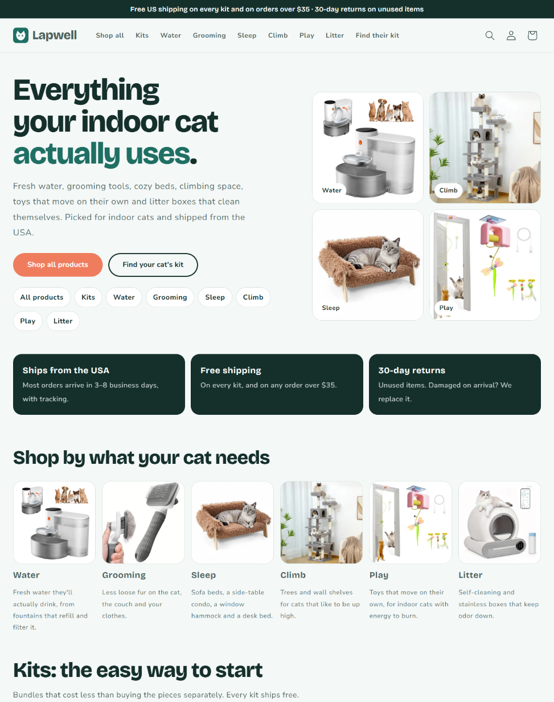
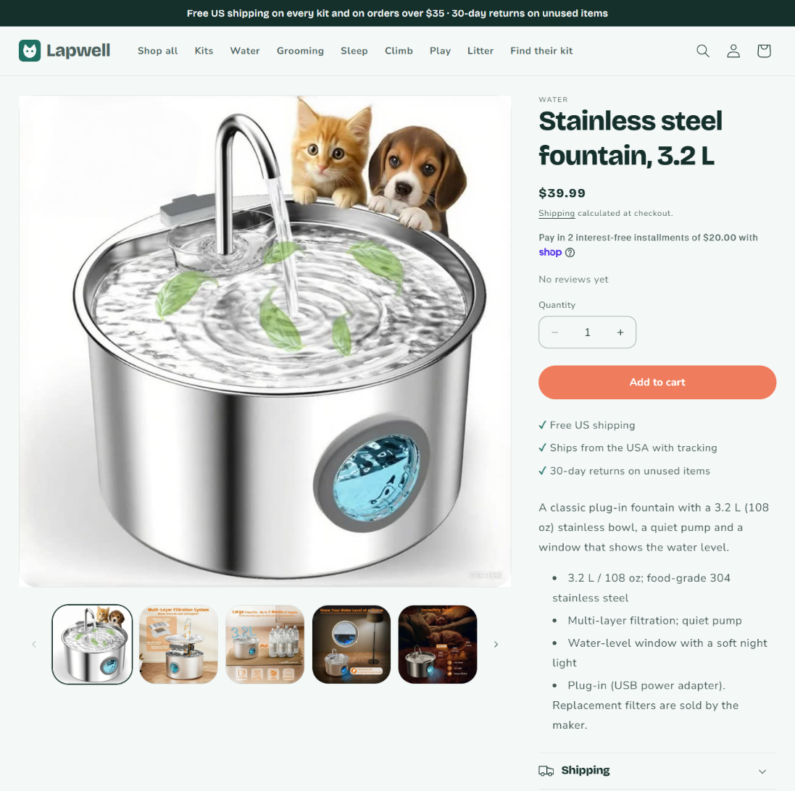

# Lapwell: building and launching a Shopify store end to end

**Live store: [getlapwell.com](https://www.getlapwell.com)**: a dropshipping store for indoor-cat products
(fountains, grooming, beds, cat trees, toys, litter boxes). Launched October 10, 2026.

Built with [Claude Code](https://claude.com/claude-code) as the hands-on agent (browser automation, scripts,
video edits); I set the direction, approved every money/terms decision and reviewed the results.

## Honest status (Oct 12, 2026)
The store is fully built, approved on Google and Facebook, and marketing posts are scheduled. **It has no sales
yet**: it's two days old with no paid ads, and the first organic videos are losing viewers in about 2 seconds.
The next step is a small, capped paid-ad test once there's a week of video data. This repo documents the
build and the process, not a business result.

## What was built
| Area | Work |
|---|---|
| Catalog | 23 products in 6 categories + 4 kits (Shopify Bundles). Every product priced with a written profit rule; 9 candidates dropped (no margin at the real supplier cost, or the supplier couldn't ship to the customer) |
| Supplier | DSers + AliExpress, US-shipping suppliers only; every product mapped; a test order confirmed the kits reach the supplier app as their component items, then it was cancelled |
| Store | Dawn theme customized (brand, logo, homepage, collections, kit pages, a "find your cat's kit" page), policies, shipping rules, SEO titles, alt text |
| Google | Search Console (domain verified, sitemap), Google & YouTube channel, Merchant Center free listings |
| Meta | Facebook Page, Facebook & Instagram channel, catalog, Meta Pixel + Conversions API; **Facebook shop approved in ~1 day** |
| Marketing | 19 AI-presenter product videos (Creatify), scheduled as a month of Facebook Reels and daily TikTok posts |
| Operations | A weekly product-run playbook ([`playbook/PRODUCT_PLAYBOOK.md`](playbook/PRODUCT_PLAYBOOK.md)) with quality, profit and safety checks, run by an AI agent with hard limits (no spending, no accounts, no payment details) |

## Problems found and fixed (the useful part)
- **Orders were auto-fulfilling.** Shopify's "fulfill automatically" setting was marking orders shipped and
  emailing customers before the supplier app ever saw them. Caught with the test order; switched to manual.
- **Bundles can't sync to Google or Facebook.** Shopify blocks fixed bundles on both channels. Kits stay
  site-only rather than un-bundling them (the supplier app depends on the bundle structure).
- **Supplier prices aren't costs.** AliExpress search shows one-time "new shopper" prices; the playbook only
  uses the supplier app's price for the exact variant + shipping to the customer.
- **Bots inflate traffic.** Early analytics showed 72 sessions; filtering to `human_or_bot_session = 'human'`
  (what Shopify's dashboard does) left 5. Reports now always use the human filter.
- **Old store leftovers.** The Shopify account had previously been a different store; the homepage SEO title
  still showed the old business name in search results and was replaced before launch.

## Repo contents
| Path | What |
|---|---|
| `playbook/PRODUCT_PLAYBOOK.md` | The weekly product-vetting and store-polish checklist |
| `scripts/build_ads.py` | Builds 15-second vertical ads with ffmpeg: licensed stock b-roll + captions + a product end card (expects the private photo/video folders) |
| `images/` | Storefront screenshots |

Supplier links, product costs and margins are deliberately not published.
